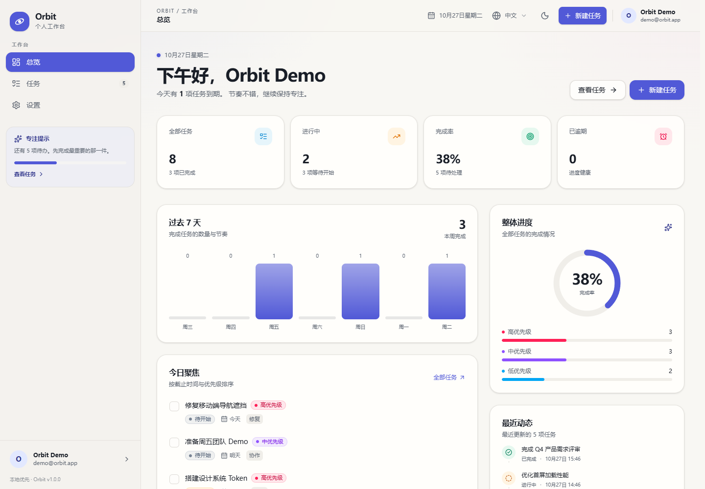
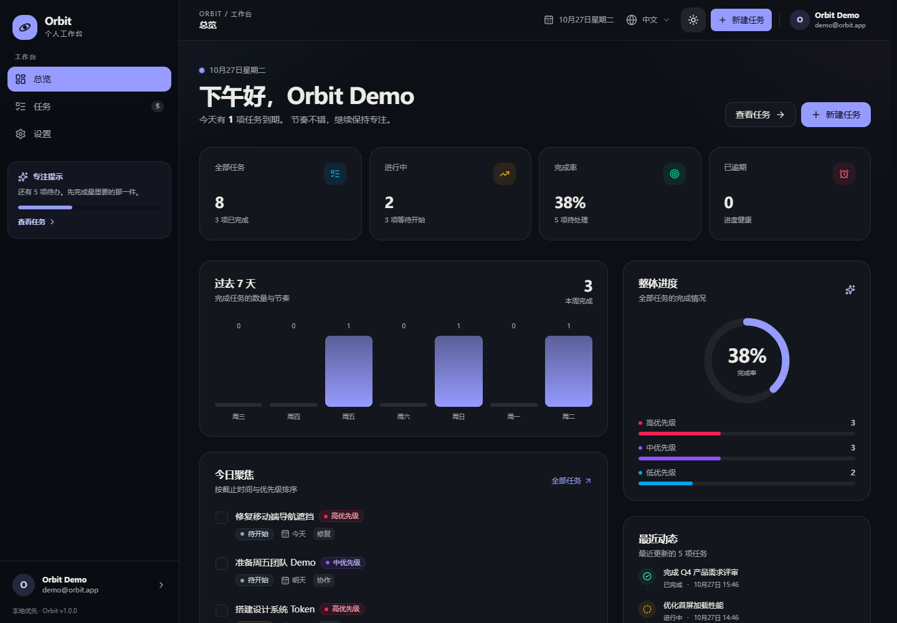
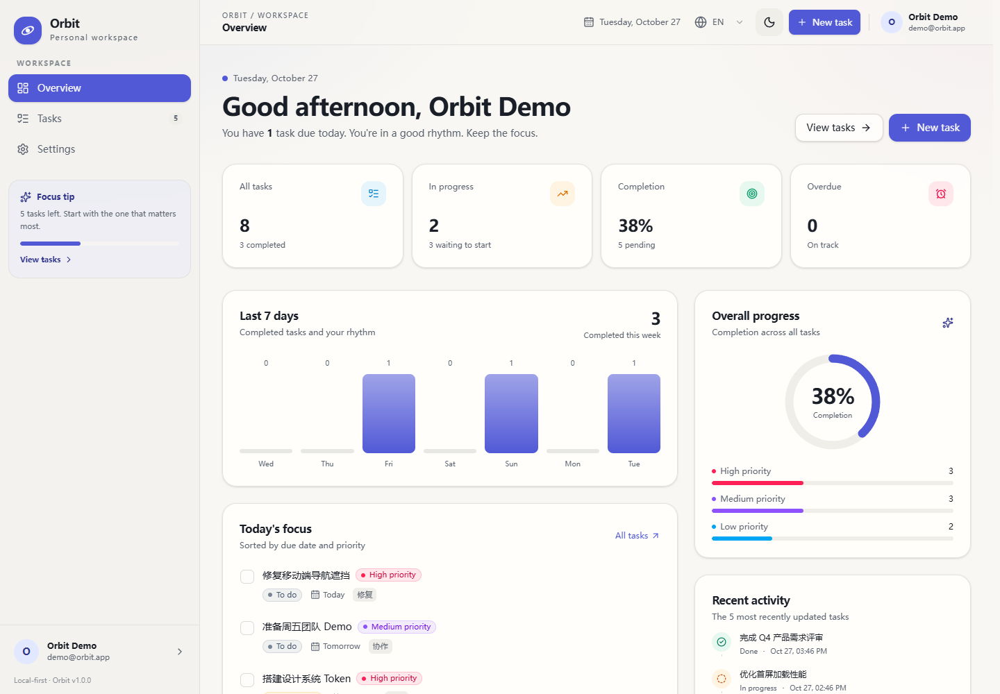
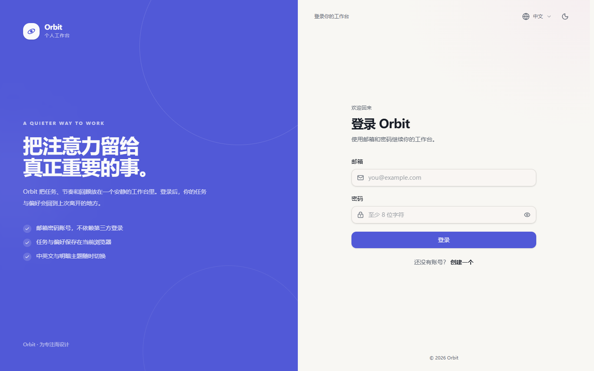
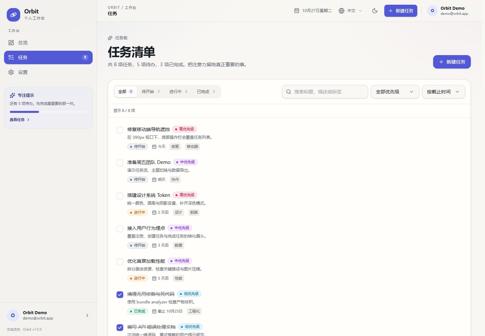
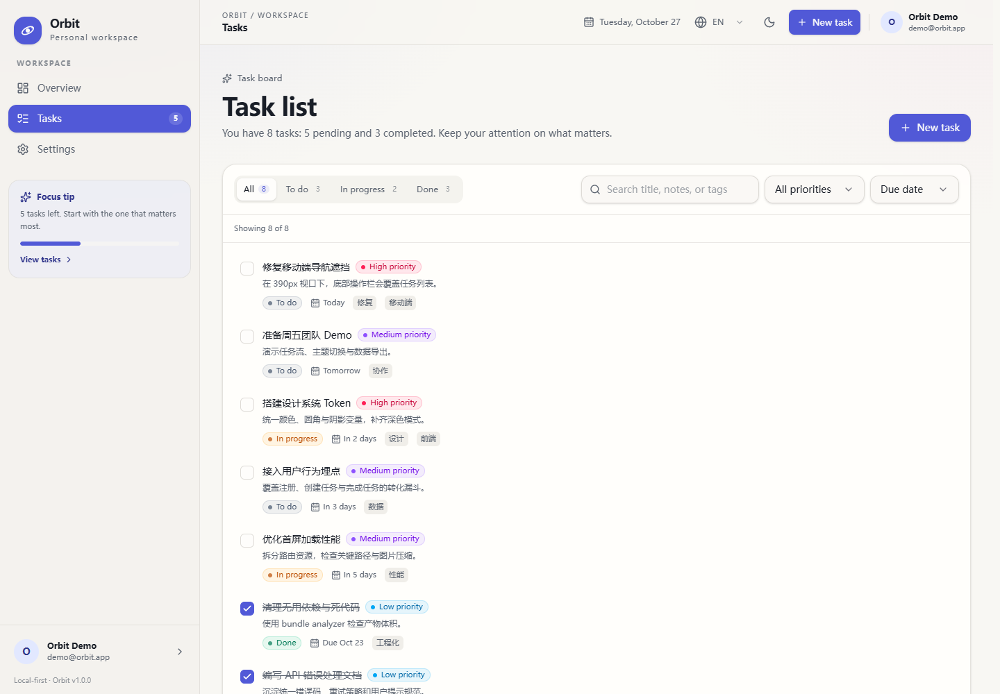
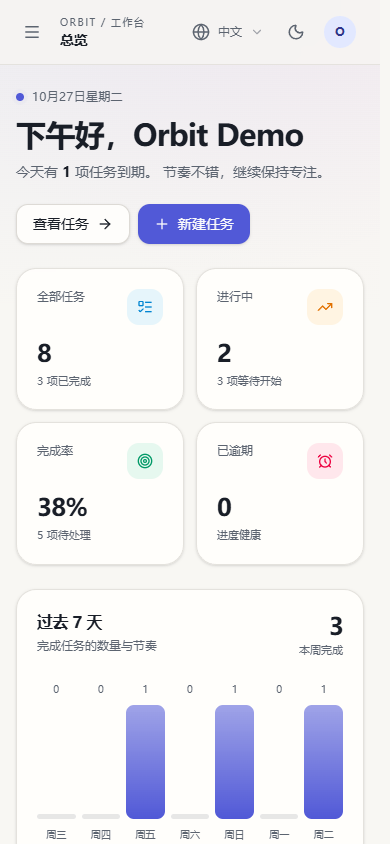
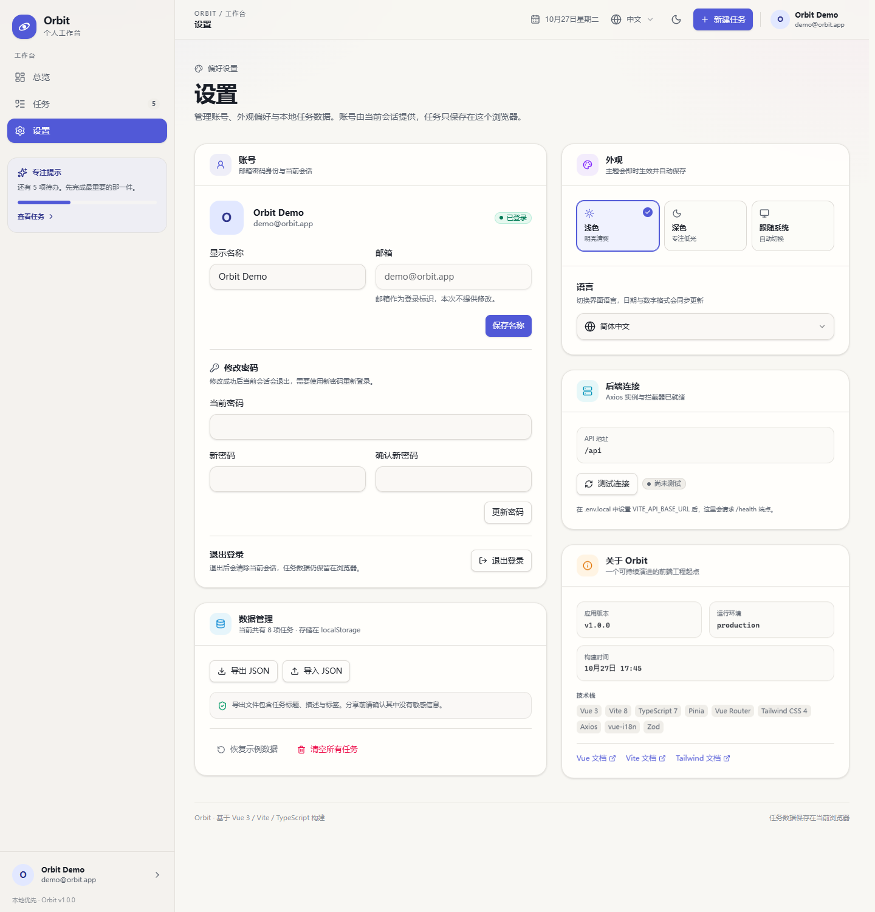

# Orbit · Vue 3 + Vite + TypeScript 工程模板

一个可直接运行、可持续演进的前端工程示例。基于当前最新稳定版 Vite 8、Vue 3.5 与 TypeScript 7，包含邮箱密码账号、受保护路由、真实可交互的任务工作台、Axios 请求层与拦截器、中英文 i18n，以及完整的测试、CI 与部署配置。



<details>
  <summary>查看深色模式与 English UI</summary>





</details>

## 文档与协作

| 文档                                                         | 内容                                   |
| ------------------------------------------------------------ | -------------------------------------- |
| [AGENTS.md](./AGENTS.md)                                     | Agent 协作硬性规则、变更分类、完成定义 |
| [specs/README.md](./specs/README.md)                         | 功能规格、计划、任务与验收流程         |
| [docs/README.md](./docs/README.md)                           | 工程文档索引与文档治理规则             |
| [docs/architecture.md](./docs/architecture.md)               | 分层、模块边界、数据流与扩展位置       |
| [docs/engineering.md](./docs/engineering.md)                 | 环境、脚本、质量门禁、依赖与测试约束   |
| [docs/framework-changelog.md](./docs/framework-changelog.md) | 非业务层框架变更的追加式记录           |

> **硬性约束：任何非业务层的框架功能变更，都必须在同一次变更中更新 [框架变更记录](./docs/framework-changelog.md)，并按 [文档更新矩阵](./AGENTS.md#31-强制文档更新矩阵) 更新受影响的文档。没有同步文档的框架变更视为未完成。**  
> CI 会通过 `pnpm docs:check` 校验关键文档存在性和相对链接。

## 快速开始

要求 **Node.js `^22.18.0 || >=24.12.0`**（推荐 Node 24 LTS）与 **pnpm 11+**。

```bash
corepack enable
corepack prepare pnpm@11.28.5 --activate
pnpm install
pnpm dev
```

打开 <http://localhost:5173>。本地开发已内置鉴权适配层，可直接使用演示账号：

```text
邮箱：demo@orbit.app
密码：OrbitDemo123!
```

也可以注册新账号。账号数据写入本地 `.data/auth-users.json`，不会提交到版本库；该适配层**不是生产后端**，生产需接入真实 `/api/auth/*` 服务。

生产构建：

```bash
pnpm build
pnpm preview
```

> 项目在 `pnpm-workspace.yaml` 中设置了 `nodeLinker: hoisted`，用扁平 `node_modules` 兼容 Windows 上对符号链接敏感的工具链。

## 功能

- **账号与鉴权**：邮箱密码注册、登录、退出、刷新会话、受保护路由、原路径回跳、显示名称与密码修改；不接入第三方登录。
- **总览仪表盘**：任务总量、完成率、逾期数量、近 7 天完成趋势、优先级分布与最近动态。
- **任务管理**：创建、编辑、完成、删除，支持状态/优先级筛选、关键词搜索和多种排序。
- **中英文 i18n**：完整界面文案切换、持久化语言偏好、`html lang`、文档标题、日期/数字格式与请求头同步更新。
- **Axios 请求层**：统一实例、`baseURL`/超时配置、鉴权头、请求 ID、`Accept-Language`、会话失效集中判定与错误归一化。
- **信封接口与缓存**：`{ code, data, message }` 类后端的解包适配器（含业务错误码），以及内存 + `localStorage` 的 TTL 缓存工具。
- **本地优先**：任务、主题和语言会自动持久化到 `localStorage`，刷新或重启浏览器后仍在；账号身份由会话 API 恢复。
- **数据边界校验**：环境变量、任务数据、导入 JSON、账号请求与表单都由 Zod 校验；损坏的本地数据会安全回退到示例数据。
- **外观与偏好**：浅色、深色、跟随系统三种主题，首屏内联脚本消除主题闪烁。
- **数据管理**：JSON 导入/导出、恢复示例数据、清空任务，破坏性操作均有确认弹窗。
- **响应式与可访问性**：移动端抽屉导航、认证页响应式布局、焦点管理、Esc 关闭、焦点陷阱、`prefers-reduced-motion`、跳过导航链接和语义化表单。
- **PWA**：manifest、Service Worker 自动更新、离线应用外壳、Chromium 安装按钮与 iOS「添加到主屏幕」引导。
- **工程化**：严格 TypeScript、路径别名、ESLint + Oxlint + Prettier、Vitest、Playwright、GitHub Actions。
- **结构门禁**：`pnpm check:components` 阻止页面入口退化成无逻辑的转发组件，已并入 `pnpm lint`。
- **可复现发布**：`deploy/build.sh` 校验环境并按锁文件构建，`deploy/publish.sh` 按缓存策略分组的 S3 发布。

### 登录与账号



- 登录与注册使用独立认证布局，桌面左右分栏、移动端单列。
- 本地开发可直接使用演示账号，生产环境需接入真实 `/api/auth/*`。
- 设置页提供显示名称、密码修改和退出登录。

### 中英文任务界面

<p>
  
  
</p>

### 移动端



## 技术栈

| 类别       | 选型                                      | 版本               |
| ---------- | ----------------------------------------- | ------------------ |
| 框架       | Vue（Composition API + `<script setup>`） | 3.5.44             |
| 构建       | Vite（Rolldown）                          | 8.3.5              |
| 编译器     | TypeScript 7 + TS 6 兼容层                | 7.0.2 / 6.0.3      |
| 类型检查   | vue-tsc（Vue SFC）                        | 3.3.13             |
| 路由       | Vue Router（history 模式、路由懒加载）    | 5.4.0              |
| 状态       | Pinia（Setup Store）                      | 4.1.0              |
| 样式       | Tailwind CSS + `@tailwindcss/vite`        | 4.3.3              |
| 国际化     | vue-i18n（Composition API）               | 11.4.16            |
| HTTP       | Axios（实例 + 请求/响应拦截器）           | 1.20.0             |
| 数据校验   | Zod                                       | 4.6.7              |
| 组合式工具 | VueUse                                    | 15.0.0             |
| 图标       | Lucide Vue                                | 1.61.0             |
| PWA        | vite-plugin-pwa（Workbox 预缓存）         | 2.0.0              |
| 单元测试   | Vitest + Vue Test Utils + jsdom           | 5.0.5              |
| 端到端测试 | Playwright                                | 1.64.1             |
| 代码质量   | ESLint + Oxlint + Prettier                | 10.13 / 1.89 / 3.9 |
| 运行时     | Node.js + pnpm                            | 24 LTS / 11.28.5   |

### TypeScript 7 的官方并存方案

TypeScript 7 是 Go 原生编译器，`tsc` 的构建速度显著提升；但它暂时不再暴露完整的旧版 Compiler API，而 `vue-tsc` 与 `typescript-eslint` 仍依赖该 API。因此项目采用 [TypeScript 官方推荐的别名并存方式](https://devblogs.microsoft.com/typescript/announcing-typescript-7-0/#running-side-by-side-with-typescript-6.0)：

```json
{
  "@typescript/native": "npm:typescript@^7.0.2",
  "typescript": "npm:@typescript/typescript6@^6.0.2"
}
```

实际效果：

```bash
pnpm exec tsc --version    # Version 7.0.2
pnpm exec tsc6 --version   # Version 6.0.3
pnpm type-check            # TS7 检查 .ts / 配置，vue-tsc 使用 TS6 API 检查 SFC
```

- **应用代码类型检查**由 TypeScript 7 执行。
- **Vue SFC 模板检查**暂时通过 TS 6 兼容 API 执行，因此当前 `pnpm type-check` 仍然是完整的。
- ESLint 的 `typescript-eslint` 也能正常运行。
- 当 `vue-tsc` 与 `typescript-eslint` 完整支持 TS 7 API 后，可以移除 `@typescript/typescript6` 兼容层、`types/vue-shim.d.ts` 与 `tsconfig.typecheck.json`，统一为单一 TypeScript 7。

> 如果只想检查 TypeScript 7 能覆盖的部分，可运行 `pnpm type-check:app`；如果只检查 Vue SFC，可运行 `pnpm type-check:vue`。

## 工程结构

```text
.
├── .github/
│   ├── dependabot.yml          # 依赖与 Actions 的自动更新
│   ├── pull_request_template.md
│   └── workflows/ci.yml        # 文档、格式、Lint、类型、单测、构建、E2E
├── AGENTS.md                   # Agent 协作硬性规则
├── deploy/
│   ├── build.sh                # 可复现发布构建（校验环境 + 构建 + 产物断言）
│   ├── publish.sh              # S3 发布（按缓存策略分组）
│   ├── deploy.env.example      # 发布凭据与目标配置示例
│   └── nginx.conf              # history 路由的 Nginx 部署示例
├── docs/
│   ├── README.md               # 文档索引与治理规则
│   ├── architecture.md         # 分层、数据流、模块边界
│   ├── engineering.md          # 环境、命令、质量门禁、约束
│   ├── framework-changelog.md  # 框架变更记录
│   └── *.png                   # README 截图
├── e2e/
│   ├── helpers.ts              # 登录、清理会话、横向溢出断言
│   ├── fixtures.ts             # 网络层假接口（CORS/OPTIONS/自动清理）
│   ├── auth.spec.ts            # 守卫、回跳、注册、改密、表单校验
│   ├── tasks.spec.ts           # 仪表盘、任务、移动端抽屉
│   ├── settings.spec.ts        # 主题、语言、后端连接成败
│   └── responsive.spec.ts      # 390 / 768 / 1440 无横向溢出
├── public/
│   ├── favicon.svg
│   ├── apple-touch-icon.png    # iOS 主屏图标（PNG，180×180）
│   └── icons/                  # PWA 192/512 与 maskable 变体
├── scripts/
│   ├── check-docs.mjs          # 文档存在性与相对链接检查
│   └── check-components.mjs    # 纯转发组件检查
├── server/
│   └── auth-mock.ts            # 仅开发/预览/E2E 的本地鉴权 API
├── specs/
│   ├── README.md               # 功能规格索引
│   ├── constitution.md         # 轻量 SDD 流程宪法
│   ├── _templates/             # spec/plan/tasks/verification 模板
│   └── 001-account-auth/       # 账号模块规格与验收
├── src/
│   ├── __tests__/              # Vitest 测试与 setup
│   ├── api/
│   │   ├── http.ts             # Axios 实例、拦截器、会话失效判定
│   │   ├── errors.ts           # ApiError 与错误归一化
│   │   ├── envelope.ts         # { code, data, message } 信封解包
│   │   ├── token.ts            # Access Token 读写
│   │   ├── auth.ts             # 注册/登录/会话/资料/密码
│   │   ├── system.ts           # /health 健康检查
│   │   └── tasks.ts            # 任务 API 契约示例
│   ├── assets/main.css         # Tailwind 入口、设计 Token、动效
│   ├── components/
│   │   ├── brand/              # 品牌 Logo
│   │   ├── layout/             # 侧边栏、顶栏
│   │   ├── tasks/              # 任务表单、列表项、徽标
│   │   └── ui/                 # Modal、Toast、主题/语言切换、安装入口
│   ├── composables/            # 主题、Toast、时间、表单、API 错误文案、安装引导
│   ├── config/env.ts           # 运行时环境变量校验
│   ├── constants/task.ts       # 状态/优先级展示元数据
│   ├── data/                   # 本地示例任务
│   ├── i18n/
│   │   ├── index.ts            # locale 检测、持久化、切换
│   │   └── messages/           # zh-CN / en-US 语言包
│   ├── layouts/
│   │   ├── AuthLayout.vue      # 登录/注册页壳
│   │   └── DefaultLayout.vue
│   ├── router/index.ts         # 懒加载路由、认证守卫、标题、滚动
│   ├── stores/                 # Pinia：Auth、任务、health 远端范式、单例实例
│   ├── types/                  # Zod Schema 与领域类型
│   ├── utils/                  # 日期、安全 redirect、TTL 缓存
│   ├── views/                  # 每个地址一个目录，入口固定 index.vue
│   │   ├── home/index.vue      # /
│   │   ├── tasks/index.vue     # /tasks
│   │   ├── settings/index.vue  # /settings
│   │   ├── login/index.vue     # /login
│   │   ├── register/index.vue  # /register
│   │   └── not-found/index.vue # 404
│   ├── App.vue                 # 布局切换与 Toast
│   └── main.ts
├── types/vue-shim.d.ts         # 让 tsc 独立检查 .ts 时忽略 SFC 实现
├── env.d.ts
├── eslint.config.ts
├── playwright.config.ts
├── tsconfig.app.json
├── tsconfig.typecheck.json     # TypeScript 7 的应用侧检查配置
├── tsconfig.node.json
├── tsconfig.vitest.json
├── vite.config.ts
└── vitest.config.ts
```

## 常用脚本

```bash
pnpm dev
pnpm build
pnpm preview
pnpm check:components   # 纯转发组件检查（已并入 pnpm lint）
bash deploy/build.sh    # 可复现发布构建
bash deploy/publish.sh  # 发布到 S3（需要 S3_BUCKET）
```

类型检查拆分、Lint、格式化、单元测试、文档检查、E2E 和完整质量门禁的权威说明见 [docs/engineering.md](./docs/engineering.md#3-命令)。

### 运行 E2E

首次运行需要浏览器：

```bash
pnpm exec playwright install chromium
pnpm test:e2e
```

如果所在网络无法下载 Playwright 浏览器，但本机安装了 Edge/Chrome，可以复用系统浏览器：

```powershell
$env:PLAYWRIGHT_CHANNEL = "msedge"   # 或 "chrome"
pnpm test:e2e
```

在 CI 中设置 `CI=true` 后，Playwright 会使用 `pnpm preview` 测试真实生产产物。本地想验证生产模式时，先 `pnpm build`，再以同样方式运行。

## 国际化（i18n）

- 语言包位于 `src/i18n/messages/zh-CN.ts` 与 `en-US.ts`，`en-US` 通过 TypeScript 类型约束保证键完整。
- 首次访问根据 `localStorage` → `navigator.language` 推断语言；切换后保存到 `orbit.locale.v1`。
- `setLocale()` 同步更新 `document.documentElement.lang`，路由层统一更新文档标题。
- 日期使用 `Intl.DateTimeFormat` 按当前 locale 格式化，相对日期文案在 `src/utils/date.ts` 中通过 vue-i18n 输出。
- 顶栏与设置页均可切换语言；Axios 请求拦截器会自动发送当前语言的 `Accept-Language`。
- 示例任务在首次生成时按当前语言创建。之后切换语言不会改写用户数据，这是有意的数据边界。

新增语言：

1. 在 `src/i18n/messages/` 新增语言包并补齐 `MessageSchema`。
2. 在 `SUPPORTED_LOCALES` 中注册显示名称。
3. 在 `i18n` 的 `messages` 中添加映射。
4. 补充日期、复数和长文案的 E2E/截图验证。

## Axios 请求层

`src/api/http.ts` 暴露一个全局 Axios 实例：

- `baseURL` 来自 `VITE_API_BASE_URL`，超时来自 `VITE_API_TIMEOUT`。
- 请求拦截器注入 `Authorization: Bearer <token>`、`X-Request-Id` 与 `Accept-Language`。
- 响应拦截器把 Axios/HTTP/后端错误归一化为 `ApiError`，UI 只需要根据 `error.code` 做 i18n 展示。
- 401 会清除 `orbit.access-token.v1` 并派发 `orbit:unauthorized` 事件；`main.ts` 统一清理 Auth Store 并跳转登录，保留原路径。
- `ApiError` 携带 `status`、`requestId`、`details`，便于日志与排障。
- `request<T>()` 返回响应体，API 模块再用 Zod 校验响应结构，避免把 `unknown` 直接断言为业务类型。

```ts
import { authApi, taskApi } from '@/api'

const session = await authApi.login({
  email: 'demo@orbit.app',
  password: 'OrbitDemo123!',
})

const tasks = await taskApi.list()
const created = await taskApi.create({
  title: 'Ship the API integration',
  description: 'Wire the task store to the backend.',
  status: 'todo',
  priority: 'high',
  dueDate: null,
  tags: ['api'],
})
```

设置页的「后端连接」卡片会调用 `GET {VITE_API_BASE_URL}/health`，用于验证代理、CORS 与拦截器链路：



开发时如果后端运行在不同端口，可以在 `vite.config.ts` 中添加代理，或把 `VITE_API_BASE_URL` 设为完整 URL 并配置后端 CORS：

```ts
export default defineConfig({
  server: {
    proxy: {
      '/api': {
        target: 'http://localhost:3000',
        changeOrigin: true,
      },
    },
  },
})
```

### 约定的接口

当前 `src/api/auth.ts` 与 `src/api/tasks.ts` 假设后端直接返回与 Zod Schema 一致的 JSON：

| 方法     | 路径             | 响应                 |
| -------- | ---------------- | -------------------- |
| `POST`   | `/auth/register` | `{ token, user }`    |
| `POST`   | `/auth/login`    | `{ token, user }`    |
| `GET`    | `/auth/me`       | `{ user }`           |
| `PATCH`  | `/auth/profile`  | `{ user }`           |
| `PUT`    | `/auth/password` | `204 No Content`     |
| `POST`   | `/auth/logout`   | `204 No Content`     |
| `GET`    | `/tasks`         | `Task[]`             |
| `POST`   | `/tasks`         | `Task`               |
| `PUT`    | `/tasks/:id`     | `Task`               |
| `DELETE` | `/tasks/:id`     | `204 No Content`     |
| `GET`    | `/health`        | `{ "status": "ok" }` |

如果后端使用 `{ code, data, message }` 包裹，在 `src/api/http.ts` 的响应拦截器中统一解包，并保留 `ApiError` 的错误码映射。当前任务 Store 仍是本地优先实现；把它接到后端时，只需替换 `src/stores/tasks.ts` 中的持久化读写，不必改动视图层。

### 账号鉴权

- 登录/注册页使用独立 `AuthLayout`，与业务应用壳分离。
- 邮箱密码账号，不接第三方登录。
- 路由守卫在首次导航时调用 `/auth/me` 恢复会话。
- 未登录访问业务页会跳转 `/login?redirect=...`，登录后回到原目标页。
- 设置页支持修改显示名称、修改密码和退出登录。
- 修改密码会撤销现有会话并要求重新登录。

本地开发由 [server/auth-mock.ts](./server/auth-mock.ts) 提供 `/api/auth/*`，账号数据保存在 `.data/auth-users.json`，密码用 `scrypt` 哈希。该文件已加入 `.gitignore`。生产必须替换为真实鉴权服务，并采用 HttpOnly Cookie、CSRF 防护、限流和审计。

### Token 说明

示例把 access token 放在 `localStorage`，便于演示请求拦截器。生产环境更推荐 HttpOnly、Secure、SameSite Cookie；如果使用 Cookie，请移除本地 token 注入并设置合适的 `withCredentials` 与 CSRF 策略。

## 环境变量

仓库不提交 `.env`；所有默认值定义在 `src/config/env.ts`。需要本地覆盖时，复制 `.env.example` 为 `.env.local`（已被 Git 忽略）：

| 变量                | 默认值   | 说明                                                     |
| ------------------- | -------- | -------------------------------------------------------- |
| `VITE_APP_TITLE`    | `Orbit`  | 页面标题后缀                                             |
| `VITE_APP_ENV`      | 自动推断 | `development` / `preview` / `production`，可在设置页展示 |
| `VITE_API_BASE_URL` | `/api`   | Axios `baseURL`；可以是相对路径或完整 URL                |
| `VITE_API_TIMEOUT`  | `10000`  | 请求超时（毫秒）                                         |

`src/config/env.ts` 会在启动时用 Zod 校验变量，配置错误会直接抛出明确异常。只有 `VITE_` 前缀变量会进入客户端包，**不要在前端环境变量中放密钥**。

## 关键设计

### 1. 数据边界统一使用 Zod

`src/types/task.ts` 同时定义 Schema 与推导类型。表单、导入文件、本地缓存读取都经过同一个 `taskDraftSchema` / `taskListSchema`，避免手写类型和运行时数据漂移。当本地缓存损坏或结构升级不兼容时，Store 会自动回退到示例数据，而不是白屏。后端响应同样由 `src/api/tasks.ts` 通过 Schema 解析。

### 2. 状态与持久化分层

- Pinia 保存唯一任务与认证状态，组件不直接操作 `localStorage`。
- `src/stores/tasks.ts` 负责读取、校验、持久化、导入导出与领域计算（统计、排序、周趋势）。
- `src/stores/auth.ts` 负责会话恢复、登录/注册/退出、资料与密码；账号资料不再写入本地 profile Store。
- 主题状态通过 VueUse `createGlobalState` 提供全局单例，保证设置页切换主题时顶栏图标与页面同步更新。
- 存储键带版本号：`orbit.tasks.v1`、`orbit.access-token.v1`、`orbit.theme.v1`、`orbit.locale.v1`。

### 3. 主题无闪烁

`index.html` 在样式加载前同步读取主题偏好并写入 `<html class="dark">`；运行时由 `useTheme` 接管系统主题监听、持久化和 `meta[theme-color]` 更新。首屏不会出现浅色闪白。

### 4. 路由与代码分割

页面通过动态 `import()` 懒加载，Vite 自动拆分 chunk；路由 meta 保存 `titleKey`、`requiresAuth`、`guestOnly` 与 `layout`。`App.vue` 根据 `meta.layout` 切换 `DefaultLayout` / `AuthLayout`，认证守卫在首次导航前恢复会话。

### 5. 可访问性

- Modal 与移动端导航都实现了焦点陷阱、Esc 关闭和焦点恢复；Modal 打开时锁定页面滚动。
- 表单控件均有显式 `label`、错误提示和 `aria-invalid`。
- 状态筛选使用 `aria-pressed`，进度条使用 `role="progressbar"`。
- 视觉动效尊重 `prefers-reduced-motion`。

### 6. 显式依赖，不做“魔法”自动导入

组件、工具和类型都显式导入，路径统一使用 `@/` 别名。自动导入、语言包预编译等能力按需再引入，避免在项目早期藏起依赖关系。

### 7. 远端 Store 范式

`src/stores/health.ts` 是接第一个真实接口时的参照实现：请求单飞（重复点击复用同一个 Promise）、只向视图暴露 `errorCode: ApiErrorCode`、派生状态用 `computed`、不为无意义的状态做持久化。带筛选或分页的列表额外要求请求竞态防护与缓存优先，规则见 [架构说明 §6.3](./docs/architecture.md#63-远端-store错误码单飞与缓存)。

视图不手拼 `apiError.<code>` 字符串，统一用 `useApiError()` 翻译；会话失效只在 `src/api/http.ts` 的 `shouldClearSession()` 一处判定。

### 8. 信封接口与 TTL 缓存

后端返回 `{ code, data, message }` 时用 `src/api/envelope.ts`：一次完成解包、业务码判定和 Zod 校验，失败归一化为 `ApiError`（`code: 'business'` 保留后端 message）。读多写少的数据可放入 `src/utils/localCache.ts`（内存 + `localStorage`，默认 TTL 30 分钟，`peek` 支持 stale-while-revalidate）；用户拥有的状态不进 TTL 缓存。

### 9. PWA

`vite-plugin-pwa` 在构建时生成 manifest 与 Workbox Service Worker（`autoUpdate`），开发服务器不注册。应用外壳离线可打开，`/api/*` 不在预缓存内。安装入口在设置页：Chromium 显示「安装到设备」，iOS 显示「分享 → 添加到主屏幕」，独立运行或已安装时不渲染。名称来自 `VITE_APP_TITLE`，图标位于 `public/icons/`。

## 测试策略

- **单元测试**：任务 Store 的增删改查、持久化、导入导出、错误数据拒绝、排序规则；Auth Store 的会话恢复、登录/退出/401/密码变更与 Zod 校验；日期工具在本地时区下的边界；任务列表组件事件；Axios 拦截器的鉴权、语言头、请求 ID 与 401 归一化。
- **端到端测试**（按域拆分）：`auth`（守卫与原路径回跳、注册/刷新会话/退出、资料修改、改密后旧凭据失效、登录与注册表单校验）、`tasks`（任务创建/完成/持久化、移动端抽屉）、`settings`（主题与语言持久化、后端连接成功与 5xx 失败并显示请求 ID）、`responsive`（390/768/1440 无横向溢出）。
- **E2E 假接口**：`e2e/fixtures.ts` 用 `page.route` 在网络层拦截，自动处理 CORS 预检并在用例结束后清理；`e2e/helpers.ts` 收敛登录与断言，避免各 spec 复制。
- **CI 顺序**：文档链接检查 → 格式检查 → Lint（含组件结构检查）→ 类型检查（TS7 + vue-tsc）→ 单测 → 构建 → Playwright E2E；失败时上传 Playwright 报告。
- 完整命令、质量门禁和故障处理以 [docs/engineering.md](./docs/engineering.md#4-完整质量门禁) 为准；本文不重复维护完整脚本表。

## 部署

`pnpm build` 产物位于 `dist/`，可部署到任意静态托管。Vue Router 使用 history 模式，服务器必须把未知路径回退到 `index.html`。仓库提供了 [deploy/nginx.conf](./deploy/nginx.conf) 示例，包含 SPA fallback、静态资源长缓存和基础安全响应头。

仓库还提供两条发布脚本：

```bash
bash deploy/build.sh --with-tests   # 校验 Node/pnpm、冻结锁文件安装、构建、断言 dist 产物
bash deploy/publish.sh --build      # 上传 S3：assets/ immutable，入口与 SW/manifest no-cache
```

- `STRICT_ENV=1 bash deploy/build.sh` 会在检测到 `.env.local` 时失败，避免本地调试配置进入生产。
- S3 目标与凭据来自环境变量或 `deploy/deploy.env.local`（复制 [deploy.env.example](./deploy/deploy.env.example)，已被 Git 忽略）。
- 不使用 S3 时只取 `dist/`，用 nginx 或任意 CDN 托管，注意把 `index.html`、`sw.js` 与 `manifest.webmanifest` 设为 `no-cache`。

账号模块还需要真实后端提供 `/api/auth/*` 与 `/api/health`；`server/auth-mock.ts` 只服务于本地开发与 E2E，不会打包进静态产物。生产需按 [账号接口契约](./specs/001-account-auth/plan.md#数据与接口) 实现服务端，并配置 Cookie/CSRF、限流和审计。

部署到子路径时，在 `vite.config.ts` 增加：

```ts
export default defineConfig(({ mode }) => {
  // ...
  return {
    base: '/your-sub-path/',
    // ...
  }
})
```

子路径部署时还要同步 PWA 的 `start_url` 与 `scope`（`vite.config.ts` 中的 `VitePWA.manifest`）。

路由已使用 `createWebHistory(import.meta.env.BASE_URL)`，无需额外改动。

## 浏览器支持

面向现代常青浏览器（最近两个大版本）。主题使用 `oklch()`、`color-mix()` 与 CSS 自定义属性，IE 及较旧的 WebView 不在支持范围内。

## 说明

这是一个前端工程示例，包含账号与任务模块，但不包含生产鉴权后端、数据库和云同步。`server/auth-mock.ts` 仅用于本地开发/预览/E2E；正式产品中请实现真实 `/api/auth/*`，将任务存储替换为经过鉴权与版本治理的 API，并按业务后端调整接口契约。

## 变更与文档约束

本项目对“框架能力”和“业务示例”做了明确区分：

- 业务变更：示例任务领域、任务文案或页面交互。
- 框架变更：依赖、构建、TypeScript、路由/状态/API 架构、i18n、主题、共享 UI、环境变量、CI、部署、Agent 规则等。

**框架变更必须在同一次提交中更新 [框架变更记录](./docs/framework-changelog.md)，并按 [AGENTS.md](./AGENTS.md) 的矩阵更新架构说明、工程说明、README 或 Agent 规则。** 未更新文档的框架变更不应合并。CI 会执行 `pnpm docs:check` 校验文档链接，PR 模板也包含文档确认项。
